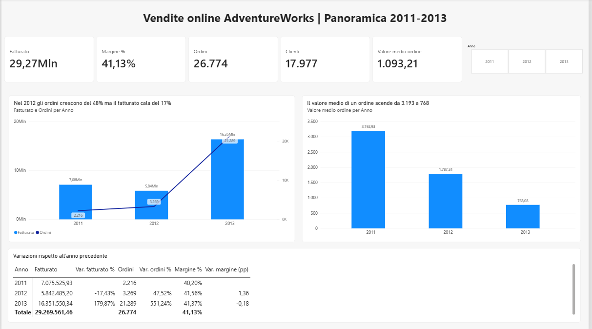
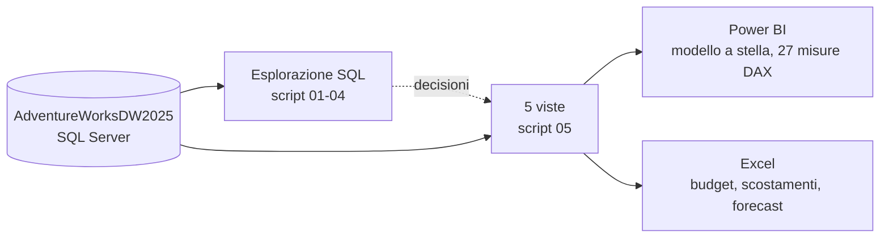
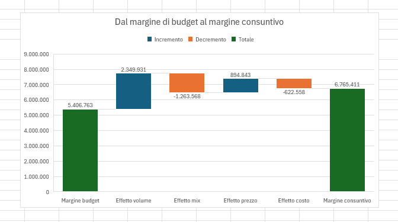
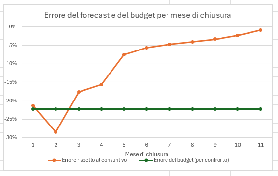

# Vendite online AdventureWorks — portfolio di Business Intelligence

Analisi completa delle vendite online di **AdventureWorks**, l'azienda di biciclette del database di esempio Microsoft **AdventureWorksDW2025**. Il progetto parte dall'esplorazione e dalla preparazione dei dati in **SQL Server**, prosegue con un report in **Power BI** e si chiude con un file di **controllo di gestione in Excel**: budget, analisi degli scostamenti e forecast.



## In breve

- **Domande**: come sono andate le vendite online tra il 2011 ed il 2013? Quali prodotti, paesi e clienti contano di più? Di quanto il 2013 si è scostato da un budget, e quanto è affidabile il forecast fatto in corso d'anno?
- **Perimetro**: si considera il solo canale online dal 2011 al 2013. In totale 29,27 milioni di fatturato, 26.774 ordini, 17.977 clienti e un margine lordo del 41,1%.
- **Strumenti**: SQL Server 2025 (T-SQL), Power BI Desktop (Power Query, modello a stella, DAX), Excel Microsoft 365 (Power Query, formule a matrice dinamica, grafici).
- **Risultato**: 6 script SQL commentati, 5 viste, un report Power BI di 6 pagine con 27 misure DAX e un file Excel di 10 fogli con 13 controlli di quadratura. I totali di Power BI ed Excel sono riconciliati con SQL.

Gli importi non hanno simbolo di valuta: sono nella valuta del dataset, presumibilmente dollari USA.

## Flusso di lavoro



## Contenuto del repository

```
sql/
  01_esplorazione_e_vendite_annuali.sql    vendite, prodotti, cross-selling, stagionalità
  02_analisi_geografica.sql                paesi, macro-aree, valuta, emisferi
  03_analisi_clienti.sql                   Pareto, clienti nuovi e ricorrenti, profilo
  04_analisi_rivenditori.sql               canale online a confronto con i rivenditori
  05_viste.sql                             5 viste per Power BI ed Excel, query di riconciliazione
  06_verifiche_per_excel.sql               verifiche di supporto al file Excel
power-bi/
  Report_Power_BI.pbix                     report (6 pagine)
  Report_Power_BI.pdf                      esportazione per chi non ha Power BI
  tema_adventureworks.json                 tema del report
  dizionario_dati.md                       tabelle, relazioni, colonne e formule delle misure
Excel/
  Controllo_Gestione_AdventureWorks.xlsx   controllo di gestione 2013 (10 fogli)
screenshot/
  power-bi/   excel/                       immagini del report e del file Excel
```

## 1. Esplorazione dei dati in SQL

Ogni script è diviso in sezioni: una domanda prima di ogni query e, sotto il risultato, commenti separati in **FATTI**, **IPOTESI** e **DECISIONI** per le viste e il report. Le ipotesi smentite restano nel file con la loro verifica.

Tecniche usate: CTE a più passi, funzioni finestra (`SUM() OVER`, `LAG`, `ROW_NUMBER`, `NTILE`), aggregazione condizionale per mettere anni o canali in colonna, `EXISTS`, controlli sulle righe perse nei JOIN.

| Anno | Ordini | Fatturato | Margine lordo % | Valore medio ordine |
|---|---:|---:|---:|---:|
| 2011 | 2.216 | 7.075.526 | 40,2% | 3.193 |
| 2012 | 3.269 | 5.842.485 | 41,6% | 1.787 |
| 2013 | 21.289 | 16.351.550 | 41,4% | 768 |

**Cosa emerge (canale online, 2011-2013)**

- **2012: più ordini, meno fatturato.** Gli ordini crescono del 48% ma il fatturato cala del 17%. Due modelli di fascia alta, Road-150 e Mountain-100, che facevano il 96,8% del fatturato 2011, escono dal catalogo e li sostituisce una gamma più economica: il prezzo medio di una bici scende da 3.193 a 1.786.
- **2013: il fatturato quasi triplica (+180%).** Dal 28 dicembre 2012 arrivano accessori, abbigliamento e bici Touring, e l'89,9% dei clienti degli anni precedenti torna a comprare. I clienti ricorrenti fanno il 64% del fatturato 2013, mentre il fatturato dei nuovi clienti resta tra 5,8 e 7,1 milioni l'anno.
- **Le bici fanno il fatturato, gli accessori i volumi.** Bikes: 96,6% del fatturato con il 26% dei pezzi. Accessories: 59% dei pezzi e 2,3% del fatturato.
- **Cross-selling.** Nel 2013 l'87,6% degli ordini con una bici contiene anche accessori, ma l'aggiunta vale in media 48 per ordine (2,9%). L'abbinamento più frequente è il casco.
- **Due tipi di cliente.** Chi compra bici e chi compra solo accessori sono gruppi separati: i clienti "con bici" sono il 51% e fanno il 98% del fatturato. Il Pareto (il primo 20% dei clienti fa il 66% del fatturato) ricalca questa separazione più che una vera regola 80/20.
- **Geografia.** Stati Uniti (32%) e Australia (31%) fanno quasi due terzi del fatturato. In Australia la spesa per cliente è il doppio di quella degli Stati Uniti (2.549 contro 1.240): la quota più alta di clienti con bici ne spiega solo una parte.
- **Online e rivenditori (script 04).** I rivenditori fanno il 73% del fatturato totale ma solo il 3,6% del margine lordo (margine dello 0,6% contro il 41,1% dell'online): le bici vendute ai rivenditori sono in perdita lorda, compensata dai componenti. Report e file Excel riguardano solo il canale online; i rivenditori restano come analisi SQL.

## 2. Viste per il modello (script 05)

Cinque viste preparano i dati riga per riga, senza aggregazioni: quote, variazioni e margini percentuali si calcolano in DAX.

| Vista | Contenuto | Righe |
|---|---|---:|
| `vw_Vendite` | fatti: una riga per riga d'ordine online, con fatturato, costo e margine | 60.398 |
| `vw_Calendario` | un giorno per riga (2010-2014), mesi in italiano, indicatore degli anni completi | 1.826 |
| `vw_Prodotti` | i prodotti venduti online, con modello, sottocategoria e categoria | 158 |
| `vw_Clienti` | profilo dei clienti, tipo cliente, data del primo ordine; nessun dato personale | 18.484 |
| `vw_Territori` | gruppo, paese, regione | 10 |

Lo script si chiude con quattro query di riconciliazione (righe, chiavi, totali per anno, tipo di cliente), usate poi per controllare Power BI ed Excel.

## 3. Report Power BI

- **Modello a stella**: la tabella `Vendite` è collegata a quattro dimensioni con relazioni uno-a-molti a direzione singola; tabella date contrassegnata; chiavi e colonne di importo nascoste, perché i grafici usano solo misure.
- **27 misure DAX** documentate: base (fatturato, margine, ordini, clienti), confronto con l'anno precedente (`SAMEPERIODLASTYEAR`, vuoto se l'anno precedente è incompleto), quote sul totale (`ALLSELECTED`), clienti nuovi e ricorrenti. Definizioni e formule nel [dizionario dei dati](power-bi/dizionario_dati.md).
- **Pagine**: Panoramica, Prodotti, Andamento mensile, Geografia, Clienti, Note sui dati, più una pagina nascosta di controlli. I titoli dei grafici dicono il risultato, per esempio "Nel 2012 gli ordini crescono del 48% ma il fatturato cala del 17%".
- Chi non ha Power BI può consultare il [PDF del report](power-bi/Report_Power_BI.pdf).

Screenshot: [Panoramica](screenshot/power-bi/01_panoramica.png) · [Prodotti](screenshot/power-bi/02_prodotti.png) · [Andamento mensile](screenshot/power-bi/03_andamento_mensile.png) · [Geografia](screenshot/power-bi/04_geografia.png) · [Clienti](screenshot/power-bi/05_clienti.png) · [Note sui dati](screenshot/power-bi/06_note_sui_dati.png)

## 4. Controllo di gestione in Excel

Il [file Excel](Excel/Controllo_Gestione_AdventureWorks.xlsx) confronta il **2013** con un **budget**, scompone gli scostamenti e misura quanto è affidabile un **forecast** fatto in corso d'anno. È indipendente dal report Power BI: stessa fonte, domande diverse.

- **Dati**: Power Query unisce tre viste e le raggruppa per mese e prodotto (1.921 righe). Nessun dato copiato a mano.
- **Budget 2013** costruito con regole dichiarate e solo dati fino al 2012, perché il database non contiene un budget per l'online.
- **Fogli**: Leggimi, Sintesi, CE_Linee (conto economico per linea fino al margine lordo), Scostamenti, Forecast, Budget, Ipotesi (tutti gli input, su sfondo giallo), Dati, Controlli, Esplorazione.
- **Formule**: tabelle strutturate, celle con nome, `LET`, `CERCA.X`, `SOMMA.PIÙ.SE`, matrici dinamiche (`FILTRO`, `UNICI`, `DATI.ORDINA`), grafico a cascata; 3 riconciliazioni con SQL e 10 controlli interni.

**Risultati**

- **Ricavi sopra il budget.** Fatturato 16,35 milioni contro 12,71 di budget (+28,7%). Touring, Accessories e Clothing, lanciate a fine 2012, pesavano il 17% del budget ma spiegano il 72% dello scostamento.
- **Margine lordo in aumento, margine percentuale in calo.** Il margine lordo supera il budget di 1,36 milioni (+25,1%), ma il margine % è 41,4% contro 42,5% (−1,2 punti).



Il volume aggiunge 2,35 milioni; il mix ne toglie 1,26, perché crescono i modelli economici di Road e Mountain; prezzo (+0,89) e costo (−0,62) vengono da tre aggiornamenti di listino, con prezzi +12% e costi +13-18%. Il calo del margine percentuale dipende soprattutto da questi costi e dal minor peso delle Mountain sul fatturato.

- **Forecast a finire.** Con i dati fino a giugno il forecast prevede 15,42 milioni: errore del −5,7% contro il −22,3% del budget. Con chiusura a novembre l'errore scende allo 0,9%. Il file calcola tre scenari (±10% sui volumi dei mesi residui).



Altri screenshot: [Sintesi](screenshot/excel/01a_sintesi.png) · [Grafici della Sintesi](screenshot/excel/01b_sintesi.png) · [Lettura dei risultati](screenshot/excel/01c_sintesi.png) · [Scostamenti per linea](screenshot/excel/02a_scostamenti.png) · [Forecast](screenshot/excel/03a_forecast.png) · [Riepilogo del forecast](screenshot/excel/03b_forecast.png) · [Controlli](screenshot/excel/04_controlli.png)

## Note sui dati e limiti

- Si confrontano solo gli anni completi 2011-2013: il 2010 (29-31 dicembre) e il 2014 (1-28 gennaio) sono esclusi.
- Margine = margine lordo (fatturato − costo standard del prodotto): nessun costo operativo, tassa o spedizione.
- I dati sono di esempio e mostrano andamenti insoliti per un'azienda reale: due modelli fanno il 96,8% del fatturato 2011 e poi spariscono; clienti di bici e di soli accessori non si mescolano mai; nel 2012 torna a comprare l'1,35% dei clienti precedenti e nel 2013 l'89,9%; margini percentuali quasi fissi per sottocategoria; ogni riga d'ordine ha quantità 1; nessuna stagionalità legata al clima tra i due emisferi. In un contesto reale ognuno di questi punti sarebbe una domanda da fare all'azienda.
- Il budget del file Excel è ricostruito: gli scostamenti mostrano il metodo di analisi, non una performance reale.

## Come riprodurre il progetto

1. Scarica `AdventureWorksDW2025.bak` dalla [pagina dei database di esempio di Microsoft](https://github.com/Microsoft/sql-server-samples/releases/tag/adventureworks) e ripristinalo in SQL Server ([istruzioni](https://learn.microsoft.com/it-it/sql/samples/adventureworks-install-configure)).
2. Esegui `sql/05_viste.sql` per creare le cinque viste. Gli script 01-04 e 06 sono esplorativi.
3. Il report Power BI e il file Excel sono collegati all'istanza locale `.\SQLDEV`: si aprono con i dati già caricati, ma per aggiornarli bisogna puntare al proprio server.
   - Power BI: Home → Trasforma dati → Impostazioni origine dati → Cambia origine.
   - Excel: Dati → Recupera dati → Impostazioni origine dati → Cambia origine.

## Competenze

- **SQL**: esplorazione di un data warehouse, controlli di qualità dei JOIN, CTE e funzioni finestra, viste per un modello a stella.
- **Power BI**: modellazione a stella, DAX (time intelligence, `CALCULATE`, `ALLSELECTED`, `KEEPFILTERS`), riconciliazione con la fonte, documentazione del modello.
- **Excel e controllo di gestione**: Power Query, budget, analisi degli scostamenti volume / mix / prezzo / costo, forecast a finire con scenari, controlli di quadratura.
- **Metodo**: distinzione tra fatti e ipotesi, verifica delle ipotesi sui dati, lettura dei limiti di un dataset.

## Autore

**Giuseppe Salonia** — laurea in economia aziendale e laurea magistrale in data science.
[LinkedIn](https://www.linkedin.com/in/giuseppe-salonia/)
